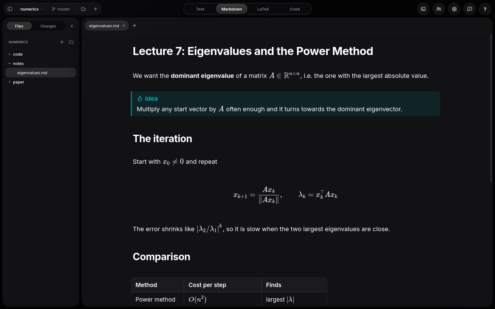
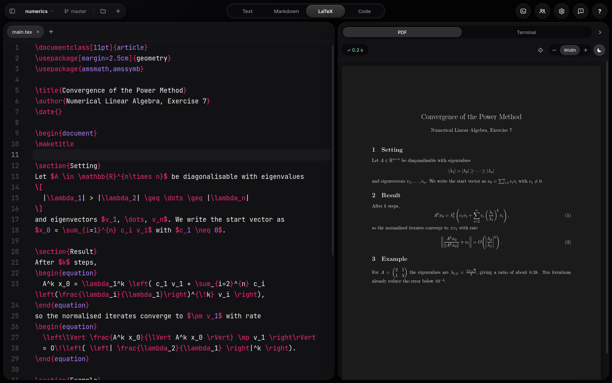

<p align="center">
  
</p>

<h1 align="center">Studio</h1>

<p align="center">
  One editor for lecture notes, LaTeX and code.<br>
  <a href="https://github.com/philippeZim/Omega/releases/latest">Download</a> ·
  <a href="#install">Install</a> ·
  <a href="#building-it-yourself">Build</a> ·
  <a href="https://github.com/philippeZim/Omega/issues">Issues</a>
</p>

<br>



I got tired of having Obsidian open for notes, Overleaf or TeXstudio for exercise sheets and VS Code for the programming assignments, all at the same time. So I started writing one app that does the three things I actually need during a semester, and does them in the same window with the same shortcuts.

Studio has four modes. You switch with `Ctrl+1` to `Ctrl+4`, and each one keeps its own layout.

**Text** is just a quiet place to write. Spell checking works in German, English and French, and you can pick the language per file.

**Markdown** renders while you type, a bit like Obsidian: headings, tables, `$math$`, callouts, task lists and images show up formatted, and the raw syntax only appears on the line you're editing.

**LaTeX** compiles on the fly with [Tectonic](https://tectonic-typesetting.github.io), so there is no TeX distribution to install. The PDF sits next to the source, and `Ctrl+J` jumps from the cursor to the matching spot in the PDF (click in the PDF to go back).



**Code** is a small IDE: language servers for completion and errors, run and test buttons that understand uv, Cargo, pnpm, CMake and Gradle projects, a debugger (breakpoints, stepping, variables) for Python, Rust, C/C++, Java and JavaScript, a terminal, Git and project-wide search. Missing language servers and debuggers are downloaded on first use, after asking.


A few other things that turned out to be useful:

- You can share a project with someone else and edit together live, peer to peer, by sending them a ticket.
- Claude Code, Codex and OpenCode can run in the terminal and see what you have open.
- `Shift Shift` searches files, symbols and commands at once. Every shortcut can be changed, and if your fingers are used to VS Code, JetBrains, Sublime or Eclipse, there's a keymap for that.
- `F1` opens a cheat sheet for the current mode (and in Code mode, for the current language).

## Install

Grab the file for your system from the [latest release](https://github.com/philippeZim/Omega/releases/latest):

| System | File |
| --- | --- |
| Windows | `Studio_…_x64-setup.exe` |
| macOS, Apple Silicon | `Studio_…_aarch64.dmg` |
| macOS, Intel | `Studio_…_x64.dmg` |
| Linux | `Studio_…_amd64.AppImage` (or the `.deb` / `.rpm`) |

The app isn't code-signed (that costs money every year), so your system will complain the first time:

- **Windows:** click *More info*, then *Run anyway*.
- **macOS:** right-click Studio in Applications and choose *Open*. If macOS says the app is damaged, run `xattr -cr /Applications/Studio.app` once.
- **Linux:** `chmod +x Studio_*.AppImage` and start it.

After that you don't have to download anything again. Studio checks for updates when it starts and asks before installing one. On Linux this only works with the AppImage; the `.deb` and `.rpm` packages have to be updated by hand.

## Found a bug?

It's early and things will break. The speech-bubble button in the top bar opens a short form. Write what happened, add a screenshot if it helps, and Studio opens a GitHub issue with your text, the app version and your OS already filled in. Paste the screenshot with `Ctrl+V` and click *Create*. You'll need a GitHub account.

Ideas are welcome the same way.

## Building it yourself

You need [Rust](https://rustup.rs), [Node.js](https://nodejs.org) and [pnpm](https://pnpm.io). On Linux, also the WebKitGTK headers:

```sh
# Debian / Ubuntu
sudo apt install libwebkit2gtk-4.1-dev libappindicator3-dev librsvg2-dev patchelf
# Arch
sudo pacman -S webkit2gtk-4.1 libappindicator-gtk3 librsvg patchelf
```

```sh
pnpm install
pnpm tauri dev                  # start in development mode
pnpm tauri dev -- -- ~/notes    # and open a folder right away
```

`pnpm tauri build` creates installers, but it also signs the update files and fails without the signing key. For a local build without updates, use `pnpm tauri build --no-bundle`.

The code is Tauri 2 with a Rust backend (`src-tauri/`) and a Svelte 5 frontend (`src/`). The editor is CodeMirror 6.

<details>
<summary>Making a release</summary>

1. Bump the version in `src-tauri/tauri.conf.json`, `package.json` and `src-tauri/Cargo.toml`.
2. Commit, tag and push: `git tag v0.2.0 && git push origin main v0.2.0`.
3. GitHub Actions builds all platforms and creates a draft release. Write the notes (people see them in the update dialog) and publish it.

The workflow needs the repository secret `TAURI_SIGNING_PRIVATE_KEY`. Its public half is in `tauri.conf.json`. If the private key is lost, installed copies can't be updated anymore, so keep a backup.

</details>

## License

[GPL-3.0](LICENSE). You can use, change and share Studio freely, but if you distribute a modified version, it has to stay open source under the same license.

The spell-checking dictionaries in `src-tauri/dicts/` come from other projects and keep their own licenses (see the `.LICENSE` files next to them).
