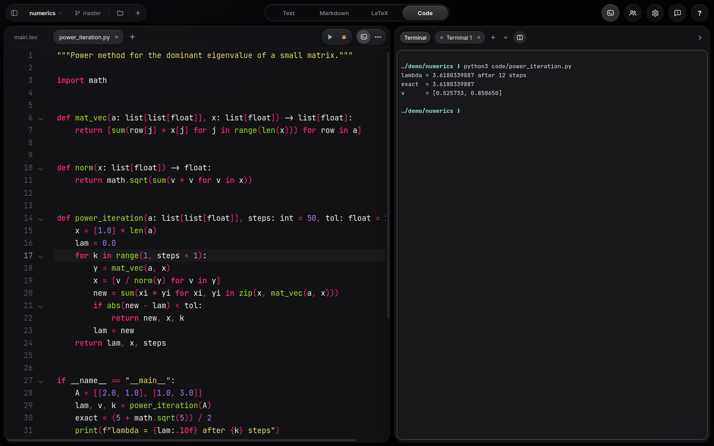

<p align="center">
  
</p>

<h1 align="center">Omega</h1>

<p align="center">
  Notes, LaTeX and code in one editor.<br><br>
  <a href="https://github.com/philippeZim/Omega/releases/latest"><b>Download</b></a> ·
  <a href="#install">Install</a> ·
  <a href="https://github.com/philippeZim/Omega/issues">Feedback</a>
</p>

<br>


Obsidian, Overleaf and VS Code in one app. Switch modes with `Ctrl+1` to `Ctrl+4`.

### LaTeX, no setup

Live PDF as you type. No TeX installation, no compile button. `Ctrl+J` jumps to your line in the PDF.

### Notes that render as you type

Formulas, tables and callouts, without Markdown clutter.


### A full IDE

Run, test and debug Python, Rust, C/C++, Java and JavaScript. Completion, terminal and Git included. Language tools set themselves up.



### Also included

- Live collaboration
- Spell checking in German, English and French
- Claude Code, Codex and OpenCode in the terminal
- `F1` for a cheat sheet in every mode

## Install

**Linux and macOS:**

```sh
curl -fsSL https://raw.githubusercontent.com/philippeZim/Omega/main/install.sh | sh
```

**Windows:** run the `…_x64-setup.exe` from the [latest release](https://github.com/philippeZim/Omega/releases/latest). The app isn't signed yet, so choose *More info → Run anyway*.

Omega updates itself.

## Feedback

Use the speech-bubble button in the top bar to report a bug with a screenshot.

## Build from source

```sh
pnpm install
pnpm tauri dev
```

Requires Rust, Node.js, pnpm and the [Tauri prerequisites](https://tauri.app/start/prerequisites/). See [docs/RELEASING.md](docs/RELEASING.md) for releases.

## License

[GPL-3.0](LICENSE). The bundled spell-checking dictionaries keep their own licenses.
