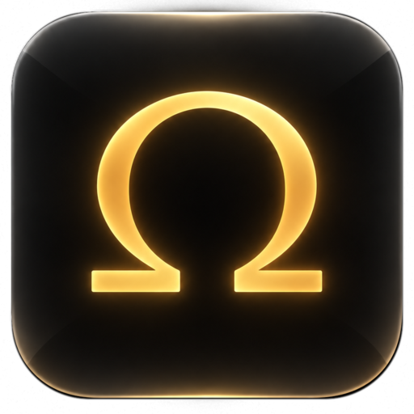

# Fixture notes

Some **bold**, *italic*, ~~strike~~, `code` and ==highlight==.

## Links

- [Relative note](notes/second.md)
- [With space](notes/with%20space.md)
- [Umlaut](notes/über.md)
- [Percent literal](notes/100%.md)
- [External](https://example.com)
- [[Wiki link]]

## Math

Inline $a^2 + b^2 = c^2$ and block:

$$
\int_0^\infty e^{-x^2}\,dx = \frac{\sqrt{\pi}}{2}
$$

## Table

| Column A | Column B with a much longer header | C |
|---|:---:|--:|
| 1 | centered | right |
| a very long cell value that should wrap or scroll somewhere | x | 3 |

## Code

```rust
fn main() { println!("hello"); }
```

## Tasks

- [ ] open
- [x] done
  - [ ] nested

> A quote
> > nested quote

---

Thiss sentense has speling mistakes. Dieser Satz hat Fehlre. Cette phrase a des fautes d'ortographe.

A very long line: Lorem ipsum dolor sit amet, consectetur adipiscing elit, sed do eiusmod tempor incididunt ut labore et dolore magna aliqua. Ut enim ad minim veniam, quis nostrud exercitation ullamco laboris nisi ut aliquip ex ea commodo consequat. Duis aute irure dolor in reprehenderit in voluptate velit esse cillum dolore eu fugiat nulla pariatur.


